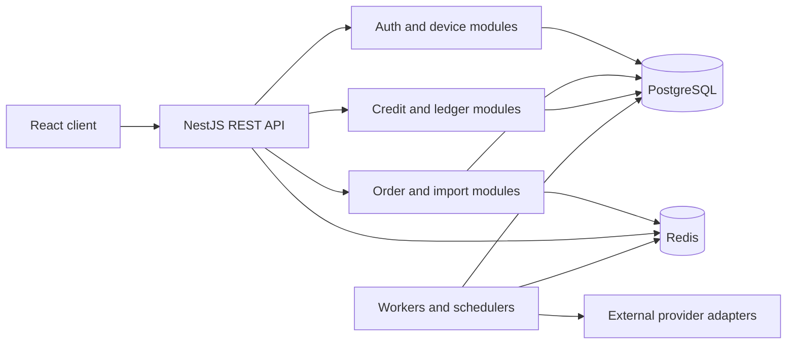

# SCLABEL Engineering Showcase

An evidence-oriented portfolio of independently rewritten backend and data-processing examples. It demonstrates engineering patterns used while developing a private order-operations platform without publishing its source code, infrastructure, credentials, customer data, or provider-specific integrations.

> **Disclosure:** the original application is private. Every executable example in this repository was written independently for this portfolio with synthetic data. The examples preserve engineering ideas, not proprietary implementation details.

## 1. Project overview

The private system coordinates order intake, credit-based billing, status workflows, administrative review, scheduled processing, and external status synchronization. This public draft focuses on the technical problems behind that work: consistency under concurrency, safe bulk ingestion, reliable background work, defensive API clients, and session security.

Repository inspection confirms a full-stack TypeScript system with React, NestJS, PostgreSQL/TypeORM, Redis, Docker Compose, and Nginx. It contains 21 NestJS modules, 20 controllers, 100 decorated HTTP handlers, 18 TypeORM entities, 27 migrations, and 24 backend test files. These are codebase counts, not usage or business metrics.

## 2. Original system context

The original application supports authenticated users and administrators managing order-like workflows with paid/unpaid states, bulk spreadsheet intake, status synchronization, account credits, notifications, and audit records. Provider names, production topology, real pricing, live endpoints, and operational data are intentionally omitted.

## 3. My role and responsibilities

The author identifies as the primary developer. Repository evidence supports hands-on responsibility across:

- React routing, protected/admin views, query caching, import and order-management interfaces.
- NestJS modules, REST controllers, validation DTOs, guards, services, and background tasks.
- PostgreSQL entities, migrations, transactional credit accounting, and concurrency control.
- Redis-backed previews, queues, and rate limiting.
- OTP login, trusted devices, refresh-token rotation, revocation, and security audit events.
- Docker/Nginx packaging, migration-based deployment, integration adapters, and automated tests.

This portfolio does not claim sole authorship of every private-repository file, business impact, traffic, user count, or production SLO.

## 4. Technology stack

| Area | Private system evidence | Public examples |
| --- | --- | --- |
| Frontend | React 18, React Router, TanStack Query, Axios, Vite, Tailwind CSS | Documentation only; no private UI copied |
| Backend | NestJS 10, TypeScript, validation pipes, modular controllers/services | Framework-free Node.js modules for easy review |
| Data | PostgreSQL, TypeORM entities and migrations | In-memory models plus a generic PostgreSQL locking pattern |
| Async | Redis lists, expiring previews, scheduled jobs | Queue port, in-memory adapter, worker retries and dead-letter flow |
| Security | JWT access tokens, OTP, refresh rotation, trusted devices, rate limits | HMAC access tokens, OTP verification, refresh-family reuse detection |
| Delivery | Docker multi-stage builds, Compose, Nginx reverse proxy | No production infrastructure dependency |
| Testing | Node test runner through `tsx --test` | Node's built-in test runner |

## 5. Architecture



The diagram is a sanitized logical view. It does not reproduce production network details.

## 6. Engineering highlights

### Transaction and concurrency control

The private system serializes balance mutations with database transactions and pessimistic row locks, then records every mutation in a ledger. The rewritten example adds an idempotency key and tests concurrent duplicate requests.

- [Executable ledger](examples/transaction-ledger/ledger.js)
- [Generic PostgreSQL pattern](examples/transaction-ledger/postgres-pattern.sql)
- [Concurrency tests](tests/transaction-ledger.test.js)

### Data processing and validation

The private import flow normalizes spreadsheet headers, validates identifiers and URLs, detects duplicates in the upload and database, creates a short-lived preview, blocks confirmation when invalid rows remain, and processes accepted rows in batches.

- [CSV import pipeline](examples/data-import-pipeline/import-pipeline.js)
- [Validation tests](tests/data-import-pipeline.test.js)

### Background work and idempotency

The private code includes a Redis list queue, a worker loop, bounded retries, scheduled tasks, and overlap guards. The public example uses an in-memory queue adapter so it runs without infrastructure while preserving retry, exponential backoff, idempotency, and dead-letter behavior.

- [Queue and worker](examples/redis-job-queue/job-queue.js)
- [Worker tests](tests/job-queue.test.js)

### Defensive API integration

The private synchronization layer implements pagination, request spacing, timeout handling, retry policies, rate-limit handling, partial results, and provider-status normalization. The public client uses an injected mock transport and never contacts a live service.

- [Tracking client](examples/api-integration/tracking-client.js)
- [Integration tests](tests/api-integration.test.js)

### Authentication lifecycle

The private application hashes OTP and refresh-token material, rotates refresh tokens, revokes device sessions after reuse, rate-limits authentication operations, and records audit events. The public example demonstrates the lifecycle with synthetic identities and Node's crypto module.

- [Authentication model](examples/authentication/session-security.js)
- [Security tests](tests/authentication.test.js)

## 7. Data processing and automation

The examples cover deterministic header canonicalization, row-level error reporting, duplicate classification, chunked processing, status normalization, queue retries, and session revocation. See [data flow](docs/data-flow.md) for the end-to-end sequence.

## 8. Security and reliability considerations

- No production credentials, URLs, data exports, screenshots, or provider payloads are included.
- Monetary values use fixed-scale integer units in the executable example.
- Ledger mutations are serialized and idempotent.
- Import validation returns row-specific errors before commit.
- Background jobs use bounded retries and a dead-letter state.
- API calls use injected transports, timeouts, pagination limits, and explicit retry rules.
- Refresh-token reuse revokes the entire token family.
- `npm run security:scan` reports only file, line, and risk type; it never prints a matched value.

More detail: [security design](docs/security-design.md).

## 9. Executable examples

```text
examples/
├── transaction-ledger/
├── data-import-pipeline/
├── redis-job-queue/
├── api-integration/
└── authentication/
```

All examples use synthetic accounts, identifiers, and responses. They share no runtime dependency with the private application.

## 10. Run locally

Requirements: Node.js 20 or newer. No database, Redis server, external API, or `.env` file is required.

```bash
npm test
npm run demo
npm run security:scan
```

Run the complete verification sequence:

```bash
npm run verify
```

## 11. Testing

The test suite verifies concurrent debit idempotency, insufficient-balance protection, transaction rollback, import normalization, duplicate detection, retry/dead-letter behavior, paginated API collection, rate-limit retry, OTP attempt limits, refresh rotation, and token-family revocation after reuse.

## 12. Limitations

- The ledger demo models PostgreSQL behavior in memory; the accompanying SQL shows the database locking pattern but is not executed in this repository.
- The queue demo uses an in-memory adapter, not a live Redis server.
- API tests use injected mock responses and do not prove compatibility with any production provider.
- Authentication code is educational and deliberately smaller than the private NestJS implementation.
- No UI, screenshot, deployment topology, real pricing, or operational metric is published.
- The original `ScanWorkerService` contains a simulated processing path; this showcase does not claim a complete carrier-activation worker.
- There is no AI/LLM component in the inspected runtime, so this portfolio makes no AI-runtime claim.

## 13. Contact

GitHub: [github.com/waitu](https://github.com/waitu)

Before publishing, review [LICENSE-NOTICE.md](LICENSE-NOTICE.md) and confirm ownership, project naming, and whether screenshots may be added.
