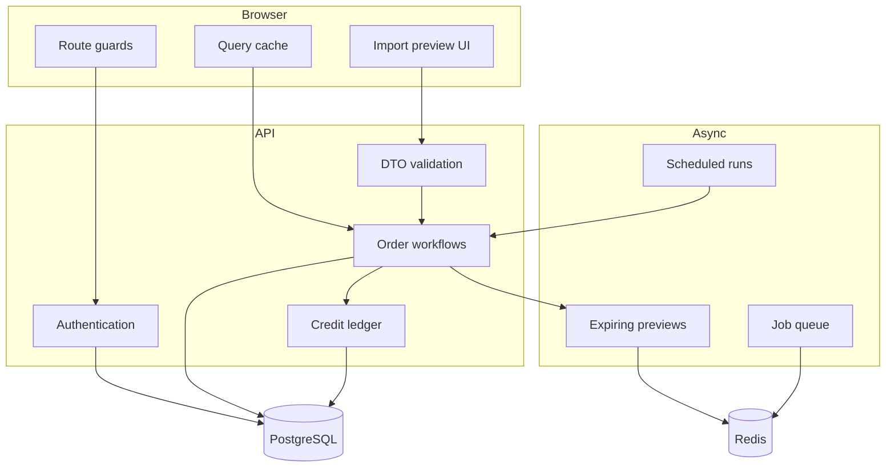

# Architecture

## Private system: verified logical structure

The inspected codebase is a modular TypeScript application:

- A React/Vite client provides guest, authenticated-user, and administrator routes.
- An Axios client attaches bearer tokens and coalesces concurrent refresh attempts.
- A NestJS API uses global DTO validation, access/admin guards, and domain modules.
- PostgreSQL persists users, devices, OTPs, tokens, orders, labels, credits, pricing, notifications, settings, and audit history.
- Redis supports expiring import previews, list-backed jobs, and sliding-window rate limits.
- Worker and scheduler services perform bounded background processing.
- Integration modules isolate provider pagination, retry, timeout, and normalization logic.
- Docker Compose builds the API, scheduled-report process, static web server, PostgreSQL, and Redis; Nginx routes SPA navigation and API traffic.

## Sanitized component view

## Boundaries in this public repository

The public examples do not reproduce controllers, database schemas, provider adapters, Docker files, UI components, brand assets, or operational configuration from the private repository. Each example is an independent implementation of a general engineering pattern.
