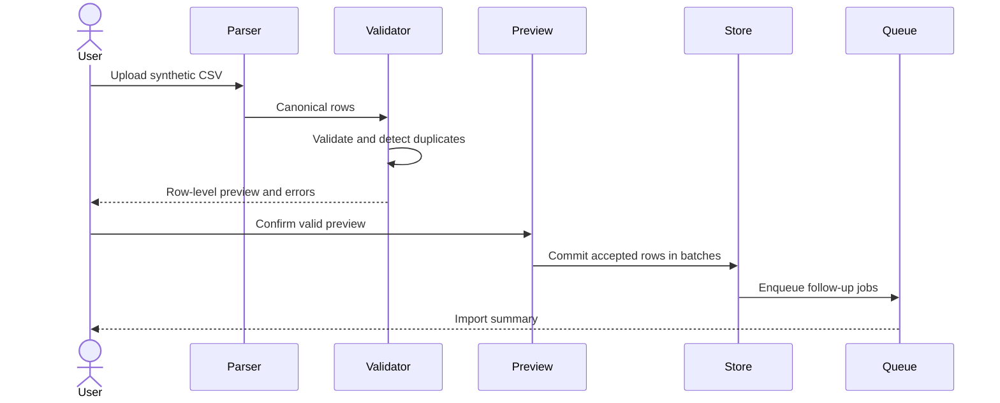
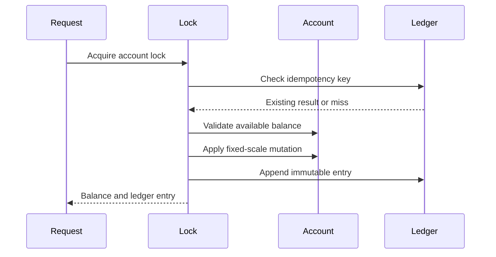
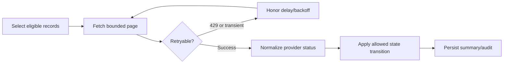

# Data flow

## Bulk import

The private system implements a two-step spreadsheet preview/confirmation flow. The public example stops at deterministic validation and chunk construction because it has no production database or queue.

## Credit mutation

## External status synchronization

